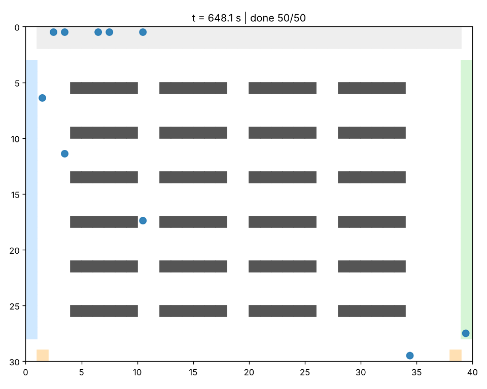

# SwarmForge

**Multi-Robot Coordination, Task Allocation & Autonomous Fleet Simulation Platform**

 
 

A research-oriented platform for multi-robot task allocation, cooperative planning, motion coordination and
reproducible fleet-scale experiments in warehouse environments.



## Overview

SwarmForge answers one question with data: *how do different coordination strategies change what a robot fleet
achieves?* It provides a deterministic core simulator, from-scratch implementations of the algorithms under
study, and an experiment framework that records configuration, seed and environment for every number it reports.

**Problem statement.** A fleet of (possibly heterogeneous) robots must complete pickup-and-delivery tasks with
deadlines and priorities in a shared warehouse, without colliding, with limited batteries and over an unreliable
network. Allocation, path planning, execution-time coordination and communication all interact.

## Key features

| Area | Implemented |
|---|---|
| Task allocation | Hungarian (shortest augmenting paths), Auction (epsilon-scaling), greedy baseline; hard feasibility masks (capability, payload, battery, reachability); reassignment with anti-oscillation policy; workload statistics |
| Planning | Dijkstra, A*, space-time A*, prioritised cooperative planning, Conflict-Based Search (vertex + edge conflicts), wait-for-graph deadlock detection, selective replanning |
| Coordination | three separate safety metrics, `none` / `basic` / `reciprocal` move arbitration, velocity obstacles, full 2-D ORCA (continuous space) |
| Robotics | differential-drive kinematics in Python and C++20 (ctypes + optional pybind11), velocity limiter, trajectories |
| Fleet | heterogeneous profiles (standard / heavy-duty / fast), energy model, charging stations, resource reservations |
| Communication | latency, jitter, packet loss, expiry, stale state cache, heartbeats, acknowledged assignments with retransmission, robot failure / disconnect |
| Platform | FastAPI REST + WebSocket, React dashboard, ROS 2 package, generated Gazebo models and worlds |
| Research | eight experiments, seeded and paired, mean/SD/CI/IQR, paired tests + effect sizes, run metadata, regression suite |

## Architecture

```text
config + seed --> Scenario --> SimulationEngine (deterministic ticks)
                                |- Fleet / Communication (latency, loss, heartbeats)
                                |- Allocation (Hungarian | Auction | greedy)
                                |- Planning (A* | Dijkstra | cooperative | CBS)
                                |- Coordination (none | basic | reciprocal) + collision monitor
                                '- Resources (battery, charging) + Metrics
 consumers: CLI, experiment runner, FastAPI/WebSocket -> React dashboard, ROS 2 bridge -> Gazebo
```

Details: [docs/architecture/system-overview.md](docs/architecture/system-overview.md).
The core simulator never depends on ROS 2 or Gazebo ([ADR-0004](docs/design-decisions/ADR-0004-core-simulator-independence.md)).

## Technology stack

Python 3.12 (NumPy, SciPy, pandas, matplotlib, PyYAML) - C++20 - CMake + scikit-build-core (+ pybind11, optional) -
FastAPI - React + TypeScript (Vite, Recharts) - ROS 2 Jazzy - Gazebo Harmonic - pytest, Hypothesis, ruff, mypy -
GitHub Actions - Docker - MkDocs Material.

## Repository structure

```text
src/swarmforge/      core simulator (core agents environment allocation planning coordination motion fleet
                     communication resources simulation metrics experiments visualization)
cpp/                 C++20 kernels, C ABI + pybind11 bindings, tests, benchmark
apps/api, apps/dashboard
infrastructure/      ros2/swarmforge_ros, gazebo/{models,worlds}, docker/
experiments/         scenarios (8 YAML), runners, analysis, results (raw / aggregated / metadata)
tests/               unit integration system regression fixtures      benchmarks/  examples/
docs/  reports/      MkDocs site, technical report, benchmark report, tables, figures
```

## Installation

```powershell
py -3.12 -m venv .venv ; .\.venv\Scripts\Activate.ps1
pip install -e ".[dev,api]"        # needs CMake + a C++ compiler (scikit-build-core)
swarmforge info
```
Pure-Python alternative without a compiler: `pip install numpy scipy pandas matplotlib pyyaml` and `PYTHONPATH=src python -m swarmforge ...`.
More: [docs/user-guide/installation.md](docs/user-guide/installation.md).

## Quick start

```bash
swarmforge run --config warehouse_medium --robots 10 --seed 42 --render final.png
swarmforge run --config warehouse_small --allocation auction --planning cbs
python experiments/runners/run_experiment.py --config experiments/scenarios/energy_aware.yaml --profile quick
python examples/multi_robot_planning/cbs_demo.py
```

## Benchmark results

All figures and tables in [reports/benchmark-report.md](reports/benchmark-report.md) were produced by
`experiments/runners/batch_runner.py --profile quick` (3-5 seeds, reduced grids) on a small shared Linux sandbox;
the exact grids, seeds, commit and hardware are in `experiments/results/metadata/`. They are *indicative*: the
full 10-seed profile has not been run. A few headline observations (details and caveats in the report):

* Optimal (Hungarian) assignment beats a greedy baseline by up to 29 % in assignment cost; the auction reaches the same cost and is faster than the pure-Python Hungarian from ~50x50 dense matrices.
* Independent A* plans collide (up to ~9 conflicts per 10-robot instance); prioritised and CBS planning are conflict-free, CBS paths are slightly shorter and slower (median 1.6x the cooperative planner at 10 robots, 7.7x at 25 % obstacle density) and can exhaust its budget.
* Wait-only collision avoidance removes collisions but livelocks (80-83 % completion); reciprocal sidestepping completes 100 % with zero collisions; coordinated plans still show safety-distance violations.
* Latency up to the 1 s plan step is absorbed; 10 % packet loss costs ~2 s thanks to acknowledged assignments; robot failures cost ~28 s.
* Without charging, energy-aware allocation avoids stranded robots (0 vs 5 depletions) but completes fewer tasks; with charging all tasks complete.
* The C++ kinematics kernel is ~28x faster than Python in batch, but 0.3x per call through ctypes - and kinematics is not the simulator's bottleneck.

## Testing

`pytest` (unit, integration, system, regression, property), `ctest --test-dir build` (C++), `make check`.
See [docs/development/testing.md](docs/development/testing.md). Continuous integration: `.github/workflows/`.

## Screenshots and terminal evidence

`docs/images/` holds renders and terminal captures produced by the commands in
[docs/images/README.md](docs/images/README.md). Nothing is edited or mocked.

## Limitations

Grid abstraction with unit speed, simplified energy and network models, incremental CBS, incomplete
prioritised planning, ORCA not wired into the grid engine, and ROS 2 / Gazebo / FastAPI / React code that was
not executed in the authoring environment. See [docs/research/limitations.md](docs/research/limitations.md).

## Roadmap

Full 10-seed runs on dedicated hardware; ORCA/continuous Mode B integration; per-robot speed in the planner;
decentralised auctions; ROS 2 services/actions; learning-based allocation ([future work](docs/research/future-work.md)).

## Citation and license

See `CITATION.cff` (repository URL and DOI to be added at release). Released under the [MIT License](LICENSE).
