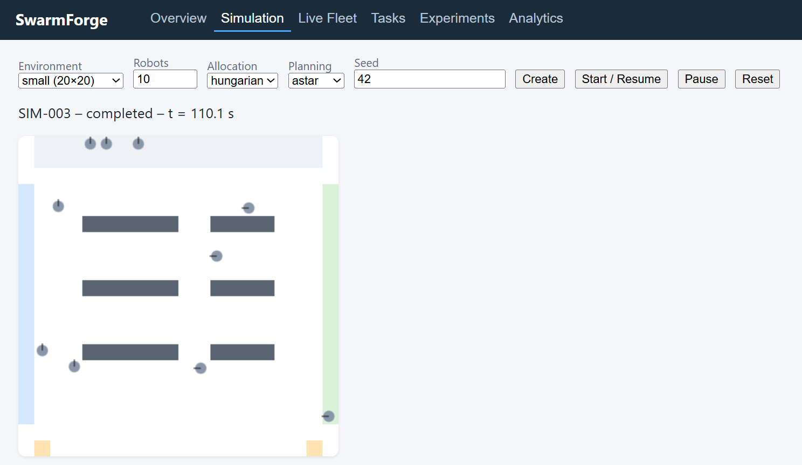
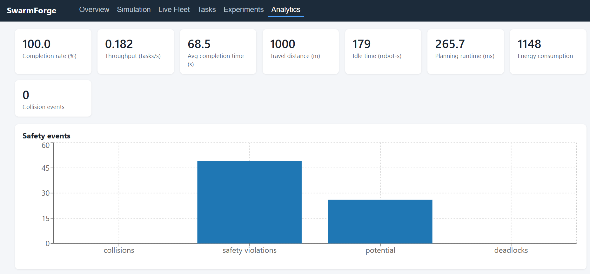
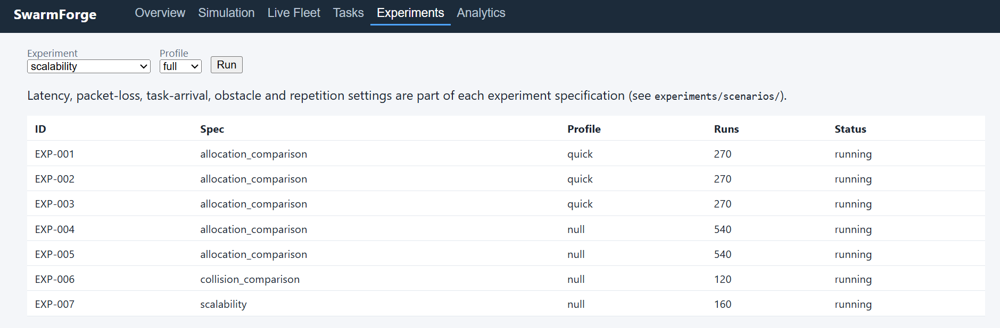
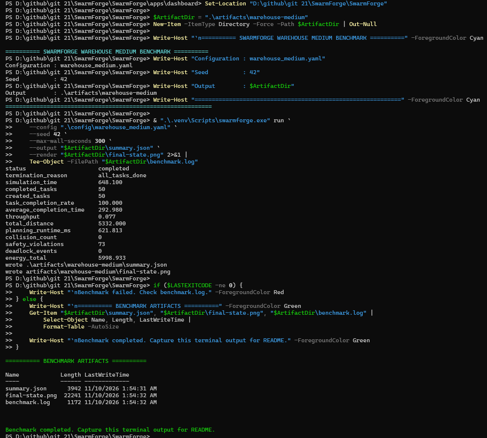
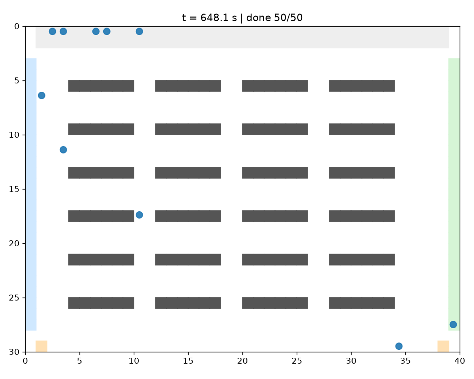

# SwarmForge

**Multi-Robot Coordination, Task Allocation & Autonomous Fleet Simulation**


SwarmForge is a research-oriented multi-robot fleet simulation platform for studying task allocation, path planning, collision avoidance, and coordinated execution in warehouse environments.

It combines a deterministic Python simulation engine, native C++ motion kernels, reproducible experiments, a REST/WebSocket API, and an interactive React dashboard.

The project explores a central research question:

> How do task allocation, path planning, and coordination strategies affect the performance and safety of a multi-robot fleet?

---

## Project at a glance

- **Simulation:** Multi-robot warehouse environments with configurable scenarios and random seeds.
- **Task allocation:** Hungarian, auction, and greedy strategies.
- **Path planning:** Dijkstra, A*, and Conflict-Based Search (CBS).
- **Coordination:** Independent, basic, and reciprocal movement arbitration.
- **Robotics:** Differential-drive motion and velocity-limiting kernels in Python and C++20.
- **Experiments:** Seeded comparisons across allocation, planning, coordination, fleet, and environment scenarios.
- **Interface:** FastAPI backend with WebSocket simulation streaming and a React dashboard.

## Dashboard

The dashboard provides an interface for inspecting simulation runs, fleet state, task progress, experiment comparisons, and performance metrics.

### Simulation



*Simulation overview showing the warehouse environment, robot fleet, and simulation controls.*

### Analytics



*Performance analytics for evaluating task completion, throughput, distance, energy, and safety-related metrics.*

### Experiment results



*Experiment comparison interface for examining the outcomes of different simulation strategies.*

## Architecture

SwarmForge separates the simulation engine from its user-facing applications and supporting infrastructure.

```text
                    Configuration + Seed
                             |
                             v
                    Scenario / Environment
                             |
                             v
                     Simulation Engine
                             |
          +------------------+------------------+
          |                  |                  |
          v                  v                  v
    Task Allocation     Path Planning      Coordination
    - Hungarian        - Dijkstra         - Independent
    - Auction          - A*               - Basic
    - Greedy           - CBS              - Reciprocal
          |                  |                  |
          +------------------+------------------+
                             |
                             v
                    Fleet & Resources
                    - Robot profiles
                    - Battery and energy
                    - Charging resources
                             |
                             v
                       Metrics & Logs
                             |
             +---------------+---------------+
             |               |               |
             v               v               v
            CLI          FastAPI / WS     Experiments
                             |
                             v
                       React Dashboard
```

The core simulator is designed to operate independently of the dashboard and API. This allows experiments and command-line simulations to run without requiring the web interface.

More details: [System Architecture](docs/architecture/system-overview.md).

## Key capabilities

| Area | Capabilities |
|---|---|
| Task allocation | Hungarian assignment, auction-based allocation, greedy baseline, feasibility-aware assignment |
| Path planning | Dijkstra, A*, space-time planning, cooperative planning, CBS |
| Coordination | Independent, basic, and reciprocal movement arbitration |
| Fleet simulation | Configurable robot fleets, heterogeneous robot profiles, task assignment and reassignment |
| Motion | Differential-drive kinematics, velocity limiting, Python and C++20 implementations |
| Resources | Battery modelling, energy metrics, charging stations and resource handling |
| Simulation | Deterministic execution, configurable environments, seeded runs and simulation summaries |
| Experiments | Batch execution, strategy comparisons, run metadata and aggregated metrics |
| Backend | FastAPI REST endpoints and WebSocket simulation streaming |
| Dashboard | React, TypeScript, Vite and interactive simulation analytics |

## Technology stack

| Layer | Technologies |
|---|---|
| Simulation engine | Python 3.12, NumPy, SciPy |
| Native computation | C++20, CMake, scikit-build-core |
| Backend | FastAPI, Pydantic, Uvicorn |
| Frontend | React, TypeScript, Vite |
| Visualisation | Matplotlib, Recharts |
| Testing | pytest, CTest, Vitest |
| Code quality | Ruff, mypy, TypeScript |
| Build and development | CMake, npm, GitHub Actions |

## Experimental results

The following results were obtained from local simulation and experiment runs. They are scenario-specific measurements, not universal performance guarantees.

### Warehouse benchmark

A medium warehouse scenario was executed with 10 robots and 50 pickup-and-delivery tasks.

| Metric | Result |
|---|---:|
| Simulation status | Completed |
| Tasks created | 50 |
| Tasks completed | 50 |
| Task completion rate | **100%** |
| Simulation time | 648.1 |
| Average completion time | 292.98 |
| Throughput | 0.077 |
| Total distance | 5,332 |
| Planning runtime | 621.813 ms |
| Actual collision count | **0** |
| Deadlock events | 0 |
| Energy consumed | 5,998.933 |

The run completed all tasks without recorded actual collisions or deadlock events. Safety-distance violations and predicted potential collisions are tracked separately from actual collision counts.

### Benchmark evidence



*Terminal output from the medium warehouse benchmark, showing the completed run and its measured metrics.*



*Rendered final state of the medium warehouse simulation.*

### Experiment findings

The project includes comparative experiments covering allocation strategies, heterogeneous fleets, scalability, collision coordination, and changing environments.

Selected findings from the recorded local runs:

- **Heterogeneous allocation:** Capability-aware allocation avoided infeasible assignments in the tested scenarios, compared with the capability-unaware baseline.
- **Scalability:** Increasing the fleet size increased measured task throughput in the tested configurations. CBS also incurred higher planning costs than A* and could reach its planning budget.
- **Collision coordination:** Independent planning could produce collisions. Reciprocal coordination completed the tested workloads with zero recorded actual collisions, while a wait-only baseline could reduce task completion.
- **Dynamic environments:** The tested obstacle, temporary blockage, new-task, and robot-failure scenarios completed with all tasks accounted for.
- **Charging:** Charging-enabled scenarios completed all tasks in the tested energy-aware experiments.

These findings should be interpreted within their experiment configurations, seeds, and simulation assumptions. Safety-distance violations, predicted conflicts, and actual collisions are distinct metrics.

## Installation

### Requirements

- Python 3.12
- C++20-compatible compiler
- CMake
- Node.js (for the dashboard)

### Set up the Python environment

```powershell
py -3.12 -m venv .venv
.\.venv\Scripts\Activate.ps1

python -m pip install --upgrade pip
pip install -e ".[dev,api]"
```

Check the installation:

```powershell
swarmforge info
```

The native motion kernels are built as part of the package installation when the required C++ build tools are available.

See the [Installation Guide](docs/user-guide/installation.md) for additional details.

## Run a simulation

From the repository root:

```powershell
swarmforge run `
  --config .\config\warehouse_medium.yaml `
  --seed 42 `
  --max-wall-seconds 300 `
  --output .\artifacts\warehouse-medium\summary.json `
  --render .\artifacts\warehouse-medium\final-state.png
```

The command produces a JSON summary and a rendered image of the final simulation state.

## Run the tests

### Python

```powershell
pytest
```

**Verified result:** 174 tests passed.

### C++ native tests

```powershell
ctest --test-dir .\build\native --output-on-failure
```

**Verified result:** 4 C++ tests passed.

### API tests

The API service test suite was run separately.

**Verified result:** 6 tests passed.

### Dashboard tests

From `apps/dashboard`:

```powershell
npm test
```

**Verified result:** 3 tests passed.

The dashboard also has a production build command:

```powershell
npm run build
```

## Repository structure

```text
SwarmForge/
├── src/
│   └── swarmforge/          # Core simulation package
├── cpp/                     # C++20 native kernels and tests
├── apps/
│   ├── api/                 # FastAPI application
│   └── dashboard/           # React + TypeScript frontend
├── config/                  # Simulation configurations
├── experiments/
│   ├── scenarios/           # Experiment configurations
│   ├── runners/             # Experiment execution
│   └── results/             # Experiment outputs and metadata
├── tests/                   # Python test suites
├── benchmarks/              # Benchmark utilities
├── examples/                # Usage examples
├── docs/
│   ├── architecture/        # Architecture documentation
│   ├── design-decisions/    # Architecture decision records
│   ├── images/              # Screenshots and simulation renders
│   └── research/            # Research notes and limitations
└── reports/                 # Technical and benchmark reports
```

## Limitations

SwarmForge is a simulation and research platform, not a deployment-ready industrial fleet controller.

Important modelling and implementation limitations include:

- Warehouse movement uses a discrete grid abstraction and simplified robot motion assumptions.
- Battery, energy, and communication behaviour are simulated models rather than calibrated hardware measurements.
- CBS and cooperative planning have computational limits as fleet size and scenario complexity increase.
- A zero actual-collision count does not imply that every safety-distance or predicted-conflict metric is zero.
- Dashboard and API capabilities should be distinguished from core simulation functionality; not every optional integration has been validated in a complete end-to-end deployment.

Further discussion: [Research Limitations](docs/research/limitations.md).

## Future work

Potential extensions include:

- Larger-scale experiments with additional seeds and dedicated hardware.
- More advanced continuous-space motion coordination.
- Improved decentralised task allocation.
- More realistic robot dynamics and energy calibration.
- Extended ROS 2 and robotics middleware integration.
- Learning-based allocation and planning approaches.

## Documentation

- [System Architecture](docs/architecture/system-overview.md)
- [Installation Guide](docs/user-guide/installation.md)
- [Testing Guide](docs/development/testing.md)
- [Research Limitations](docs/research/limitations.md)
- [Future Work](docs/research/future-work.md)

## License

This project is released under the MIT License. See [LICENSE](LICENSE).
