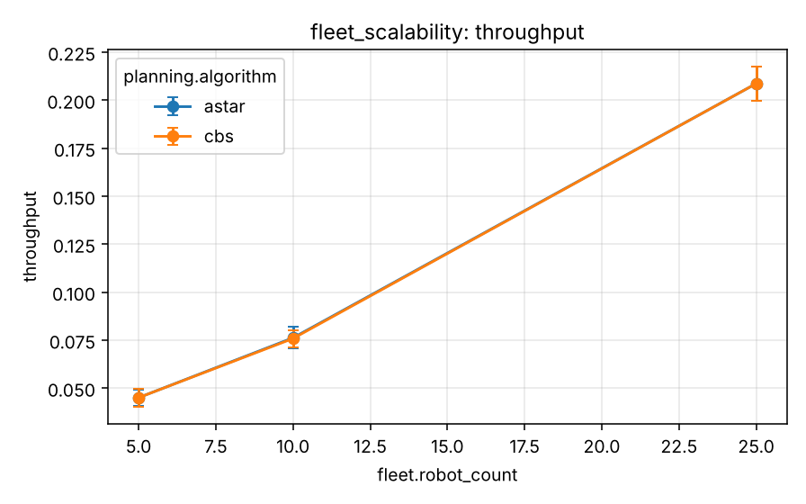

# Experiment 1 - Fleet scalability

**Research question.** How does increasing fleet size affect coordination overhead and overall task performance?

## Design

`experiments/scenarios/scalability.yaml`. Full profile: robots 5/10/25/50 x {Hungarian, Auction} x {A*, CBS}, 100 tasks, 10 seeds. **Quick profile (what was run):** robots 5/10/25, Hungarian, {A*, CBS}, 40 tasks, 3 seeds, CBS limit 0.5 s per call.

## Metrics

Throughput, average completion time, planning runtime, wait steps and safety events per run. CPU utilisation was not measured (wall time of the planner is reported instead).

## Results

Generated from `experiments/results/raw/fleet_scalability.csv` (mean, SD, 95 % CI per cell; n = seeds x pooled factor levels).

<!-- BEGIN table:fleet_scalability -->

**task_completion_rate**

| planning.algorithm | fleet.robot_count | n | mean | SD | 95% CI |
|---|---|---|---|---|---|
| astar | 5 | 3 | 100.0 | 0.0 | [100.0, 100.0] |
| astar | 10 | 3 | 100.0 | 0.0 | [100.0, 100.0] |
| astar | 25 | 3 | 100.0 | 0.0 | [100.0, 100.0] |
| cbs | 5 | 3 | 100.0 | 0.0 | [100.0, 100.0] |
| cbs | 10 | 3 | 100.0 | 0.0 | [100.0, 100.0] |
| cbs | 25 | 3 | 100.0 | 0.0 | [100.0, 100.0] |

**throughput**

| planning.algorithm | fleet.robot_count | n | mean | SD | 95% CI |
|---|---|---|---|---|---|
| astar | 5 | 3 | 0.045 | 0.002 | [0.041, 0.049] |
| astar | 10 | 3 | 0.076 | 0.002 | [0.071, 0.082] |
| astar | 25 | 3 | 0.209 | 0.004 | [0.200, 0.217] |
| cbs | 5 | 3 | 0.045 | 0.002 | [0.040, 0.050] |
| cbs | 10 | 3 | 0.076 | 0.002 | [0.071, 0.080] |
| cbs | 25 | 3 | 0.209 | 0.004 | [0.200, 0.217] |

**average_completion_time**

| planning.algorithm | fleet.robot_count | n | mean | SD | 95% CI |
|---|---|---|---|---|---|
| astar | 5 | 3 | 426.592 | 16.087 | [386.628, 466.555] |
| astar | 10 | 3 | 229.917 | 6.147 | [214.647, 245.187] |
| astar | 25 | 3 | 112.583 | 0.563 | [111.186, 113.981] |
| cbs | 5 | 3 | 427.108 | 15.374 | [388.918, 465.299] |
| cbs | 10 | 3 | 229.725 | 6.410 | [213.802, 245.648] |
| cbs | 25 | 3 | 112.542 | 0.586 | [111.085, 113.999] |

**planning_runtime_ms**

| planning.algorithm | fleet.robot_count | n | mean | SD | 95% CI |
|---|---|---|---|---|---|
| astar | 5 | 3 | 65.950 | 5.937 | [51.202, 80.698] |
| astar | 10 | 3 | 99.272 | 31.815 | [20.239, 178.304] |
| astar | 25 | 3 | 189.964 | 29.820 | [115.888, 264.040] |
| cbs | 5 | 3 | 262.720 | 265.133 | [-395.906, 921.346] |
| cbs | 10 | 3 | 488.521 | 227.403 | [-76.378, 1053.420] |
| cbs | 25 | 3 | 856.223 | 331.074 | [33.788, 1678.657] |

**wait_steps**

| planning.algorithm | fleet.robot_count | n | mean | SD | 95% CI |
|---|---|---|---|---|---|
| astar | 5 | 3 | 0.000 | 0.000 | [0.000, 0.000] |
| astar | 10 | 3 | 0.000 | 0.000 | [0.000, 0.000] |
| astar | 25 | 3 | 0.000 | 0.000 | [0.000, 0.000] |
| cbs | 5 | 3 | 0.000 | 0.000 | [0.000, 0.000] |
| cbs | 10 | 3 | 0.000 | 0.000 | [0.000, 0.000] |
| cbs | 25 | 3 | 0.000 | 0.000 | [0.000, 0.000] |

<!-- END table:fleet_scalability -->

Figures (mean with 95 % CI): see `docs/images/benchmarks/fleet_scalability__*.png`.

## Discussion

Throughput rises almost proportionally with fleet size over 5-25 robots (about 4.6x for 5x robots) and completion time falls accordingly. Planning runtime per run grows with fleet size. CBS and cooperative A* yield identical simulated outcomes here; CBS multiplies planning runtime by roughly 4-5x and fell back to prioritised planning in 0.3-1.3 runs on average (node/time limit). 50 robots and the 100-task workload were not run.

Interpretation is limited by the quick profile (few seeds, wide CIs; see the [methodology](../research/experimental-methodology.md))
and the abstractions listed in the [limitations](../research/limitations.md). Paired statistics for selected contrasts:
`reports/tables/paired_comparisons.md`.
