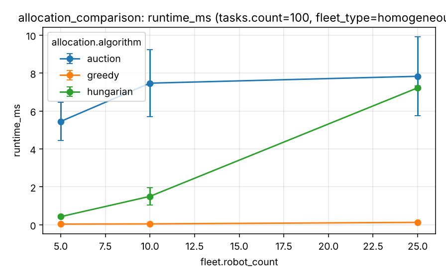

# Experiment 2 - Task allocation comparison

**Research question.** How do centralised assignment (Hungarian), auction-based allocation and a greedy baseline differ in computational cost and allocation quality?

## Design

`experiments/scenarios/allocation_comparison.yaml`, kind `allocation`: cost matrices built from simulated warehouses (`warehouse_large`), 5/10/25 robots x 20/50/100 tasks x homogeneous/heterogeneous fleet, 5 seeds (quick; full = 10), runtime = median of 3 repeats. All algorithms receive the same matrix, feasibility mask and objective.

## Metrics

Runtime (ms), total cost, assignment success rate (assigned / min(N, M)), unassigned tasks, cost gap to Hungarian, auction iterations and convergence flag.

## Results

Generated from `experiments/results/raw/allocation_comparison.csv` (mean, SD, 95 % CI per cell; n = seeds x pooled factor levels).

<!-- BEGIN table:allocation_comparison -->

**runtime_ms**

| allocation.algorithm | fleet.robot_count | tasks.count | n | mean | SD | 95% CI |
|---|---|---|---|---|---|---|
| auction | 5 | 20 | 10 | 1.542 | 0.428 | [1.236, 1.849] |
| auction | 5 | 50 | 10 | 4.434 | 1.641 | [3.261, 5.608] |
| auction | 5 | 100 | 10 | 7.689 | 2.763 | [5.712, 9.666] |
| auction | 10 | 20 | 10 | 1.473 | 0.377 | [1.204, 1.743] |
| auction | 10 | 50 | 10 | 3.699 | 0.421 | [3.398, 4.001] |
| auction | 10 | 100 | 10 | 8.090 | 1.315 | [7.149, 9.030] |
| auction | 25 | 20 | 10 | 1.800 | 0.468 | [1.465, 2.135] |
| auction | 25 | 50 | 10 | 3.775 | 1.408 | [2.768, 4.782] |
| auction | 25 | 100 | 10 | 8.615 | 1.797 | [7.329, 9.901] |
| greedy | 5 | 20 | 10 | 0.022 | 0.003 | [0.020, 0.024] |
| greedy | 5 | 50 | 10 | 0.032 | 0.015 | [0.021, 0.043] |
| greedy | 5 | 100 | 10 | 0.037 | 0.005 | [0.034, 0.040] |
| greedy | 10 | 20 | 10 | 0.030 | 0.002 | [0.028, 0.032] |
| greedy | 10 | 50 | 10 | 0.038 | 0.007 | [0.033, 0.044] |
| greedy | 10 | 100 | 10 | 0.046 | 0.004 | [0.043, 0.049] |
| greedy | 25 | 20 | 10 | 0.071 | 0.011 | [0.064, 0.079] |
| greedy | 25 | 50 | 10 | 0.092 | 0.023 | [0.076, 0.108] |
| greedy | 25 | 100 | 10 | 0.143 | 0.038 | [0.116, 0.170] |
| hungarian | 5 | 20 | 10 | 0.114 | 0.022 | [0.099, 0.130] |
| hungarian | 5 | 50 | 10 | 0.220 | 0.055 | [0.180, 0.259] |
| hungarian | 5 | 100 | 10 | 0.407 | 0.056 | [0.368, 0.447] |
| hungarian | 10 | 20 | 10 | 0.284 | 0.066 | [0.237, 0.332] |
| hungarian | 10 | 50 | 10 | 0.565 | 0.123 | [0.477, 0.654] |
| hungarian | 10 | 100 | 10 | 1.272 | 0.367 | [1.009, 1.535] |
| hungarian | 25 | 20 | 10 | 0.955 | 0.196 | [0.815, 1.096] |
| hungarian | 25 | 50 | 10 | 3.188 | 0.585 | [2.770, 3.607] |
| hungarian | 25 | 100 | 10 | 6.338 | 1.262 | [5.436, 7.241] |

**cost_gap_vs_hungarian_pct**

| allocation.algorithm | fleet.robot_count | tasks.count | n | mean | SD | 95% CI |
|---|---|---|---|---|---|---|
| auction | 5 | 20 | 10 | 0.000 | 0.000 | [0.000, 0.000] |
| auction | 5 | 50 | 10 | 0.000 | 0.000 | [-0.000, 0.000] |
| auction | 5 | 100 | 10 | 0.000 | 0.000 | [-0.000, 0.000] |
| auction | 10 | 20 | 10 | 0.000 | 0.000 | [-0.000, 0.000] |
| auction | 10 | 50 | 10 | 0.000 | 0.000 | [0.000, 0.000] |
| auction | 10 | 100 | 10 | 0.000 | 0.000 | [-0.000, 0.000] |
| auction | 25 | 20 | 10 | 0.000 | 0.000 | [-0.000, 0.000] |
| auction | 25 | 50 | 10 | 0.000 | 0.000 | [-0.000, 0.000] |
| auction | 25 | 100 | 10 | 0.000 | 0.000 | [-0.000, 0.000] |
| greedy | 5 | 20 | 10 | 16.409 | 3.275 | [14.066, 18.752] |
| greedy | 5 | 50 | 10 | 25.924 | 6.492 | [21.279, 30.568] |
| greedy | 5 | 100 | 10 | 29.203 | 6.995 | [24.199, 34.207] |
| greedy | 10 | 20 | 10 | 10.366 | 2.874 | [8.310, 12.422] |
| greedy | 10 | 50 | 10 | 20.043 | 6.003 | [15.749, 24.337] |
| greedy | 10 | 100 | 10 | 24.525 | 6.026 | [20.215, 28.836] |
| greedy | 25 | 20 | 10 | 0.092 | 0.145 | [-0.012, 0.196] |
| greedy | 25 | 50 | 10 | 10.433 | 2.265 | [8.813, 12.053] |
| greedy | 25 | 100 | 10 | 16.645 | 1.892 | [15.292, 17.999] |
| hungarian | 5 | 20 | 10 | 0.000 | 0.000 | [0.000, 0.000] |
| hungarian | 5 | 50 | 10 | 0.000 | 0.000 | [0.000, 0.000] |
| hungarian | 5 | 100 | 10 | 0.000 | 0.000 | [0.000, 0.000] |
| hungarian | 10 | 20 | 10 | 0.000 | 0.000 | [0.000, 0.000] |
| hungarian | 10 | 50 | 10 | 0.000 | 0.000 | [0.000, 0.000] |
| hungarian | 10 | 100 | 10 | 0.000 | 0.000 | [0.000, 0.000] |
| hungarian | 25 | 20 | 10 | 0.000 | 0.000 | [0.000, 0.000] |
| hungarian | 25 | 50 | 10 | 0.000 | 0.000 | [0.000, 0.000] |
| hungarian | 25 | 100 | 10 | 0.000 | 0.000 | [0.000, 0.000] |

**assignment_success_rate**

| allocation.algorithm | fleet.robot_count | tasks.count | n | mean | SD | 95% CI |
|---|---|---|---|---|---|---|
| auction | 5 | 20 | 10 | 100.0 | 0.0 | [100.0, 100.0] |
| auction | 5 | 50 | 10 | 100.0 | 0.0 | [100.0, 100.0] |
| auction | 5 | 100 | 10 | 100.0 | 0.0 | [100.0, 100.0] |
| auction | 10 | 20 | 10 | 100.0 | 0.0 | [100.0, 100.0] |
| auction | 10 | 50 | 10 | 100.0 | 0.0 | [100.0, 100.0] |
| auction | 10 | 100 | 10 | 100.0 | 0.0 | [100.0, 100.0] |
| auction | 25 | 20 | 10 | 100.0 | 0.0 | [100.0, 100.0] |
| auction | 25 | 50 | 10 | 100.0 | 0.0 | [100.0, 100.0] |
| auction | 25 | 100 | 10 | 100.0 | 0.0 | [100.0, 100.0] |
| greedy | 5 | 20 | 10 | 100.0 | 0.0 | [100.0, 100.0] |
| greedy | 5 | 50 | 10 | 100.0 | 0.0 | [100.0, 100.0] |
| greedy | 5 | 100 | 10 | 100.0 | 0.0 | [100.0, 100.0] |
| greedy | 10 | 20 | 10 | 100.0 | 0.0 | [100.0, 100.0] |
| greedy | 10 | 50 | 10 | 100.0 | 0.0 | [100.0, 100.0] |
| greedy | 10 | 100 | 10 | 100.0 | 0.0 | [100.0, 100.0] |
| greedy | 25 | 20 | 10 | 100.0 | 0.0 | [100.0, 100.0] |
| greedy | 25 | 50 | 10 | 100.0 | 0.0 | [100.0, 100.0] |
| greedy | 25 | 100 | 10 | 100.0 | 0.0 | [100.0, 100.0] |
| hungarian | 5 | 20 | 10 | 100.0 | 0.0 | [100.0, 100.0] |
| hungarian | 5 | 50 | 10 | 100.0 | 0.0 | [100.0, 100.0] |
| hungarian | 5 | 100 | 10 | 100.0 | 0.0 | [100.0, 100.0] |
| hungarian | 10 | 20 | 10 | 100.0 | 0.0 | [100.0, 100.0] |
| hungarian | 10 | 50 | 10 | 100.0 | 0.0 | [100.0, 100.0] |
| hungarian | 10 | 100 | 10 | 100.0 | 0.0 | [100.0, 100.0] |
| hungarian | 25 | 20 | 10 | 100.0 | 0.0 | [100.0, 100.0] |
| hungarian | 25 | 50 | 10 | 100.0 | 0.0 | [100.0, 100.0] |
| hungarian | 25 | 100 | 10 | 100.0 | 0.0 | [100.0, 100.0] |

<!-- END table:allocation_comparison -->

Figures (mean with 95 % CI): see `docs/images/benchmarks/allocation_comparison__*.png`.

## Discussion

Auction matched Hungarian's cost in every run (it always converged; its stated bound is 0.001 per pair). Hungarian was faster on these matrices (median 0.41 ms vs 7.4 ms at 5 x 100); the gap closes as the fleet grows and the auction overtakes it on dense square matrices of size >= 50 (`benchmarks/allocation/bench_allocation.py`). Greedy is 10x-100x faster but pays up to 29 % in cost. Hungarian is a pure-Python O(n^2 m) implementation: absolute runtimes say nothing about optimised libraries.

Interpretation is limited by the quick profile (few seeds, wide CIs; see the [methodology](../research/experimental-methodology.md))
and the abstractions listed in the [limitations](../research/limitations.md). Paired statistics for selected contrasts:
`reports/tables/paired_comparisons.md`.
