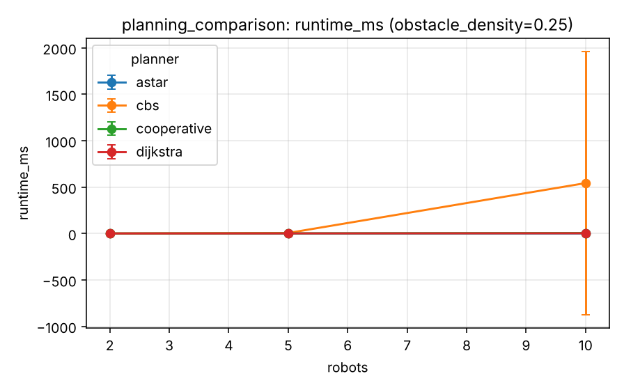

# Experiment 3 - Path planning comparison

**Research question.** How do single-agent search (Dijkstra, A*), prioritised cooperative planning and CBS compare in cost, runtime, expanded nodes, conflicts and success?

## Design

`experiments/scenarios/planning_comparison.yaml`, kind `mapf`: random start/goal instances on a 20x20 map (density 5 % and 25 %), 2/5/10 robots (full profile: 2/5/10/20, densities 5/15/25 %), 5 seeds, whole-instance planning (all robots at once). CBS limit 2000 nodes / 3 s (quick).

## Metrics

Success, sum of costs relative to the sum of single-agent shortest paths (a lower bound), runtime, expanded low-level nodes, high-level nodes, conflicts in the returned paths.

## Results

Generated from `experiments/results/raw/planning_comparison.csv` (mean, SD, 95 % CI per cell; n = seeds x pooled factor levels).

<!-- BEGIN table:planning_comparison -->

**success**

| planner | robots | n | mean | SD | 95% CI |
|---|---|---|---|---|---|
| astar | 2 | 10 | 1.000 | 0.000 | [1.000, 1.000] |
| astar | 5 | 10 | 1.000 | 0.000 | [1.000, 1.000] |
| astar | 10 | 10 | 1.000 | 0.000 | [1.000, 1.000] |
| cbs | 2 | 10 | 1.000 | 0.000 | [1.000, 1.000] |
| cbs | 5 | 10 | 1.000 | 0.000 | [1.000, 1.000] |
| cbs | 10 | 10 | 0.900 | 0.316 | [0.674, 1.126] |
| cooperative | 2 | 10 | 1.000 | 0.000 | [1.000, 1.000] |
| cooperative | 5 | 10 | 1.000 | 0.000 | [1.000, 1.000] |
| cooperative | 10 | 10 | 1.000 | 0.000 | [1.000, 1.000] |
| dijkstra | 2 | 10 | 1.000 | 0.000 | [1.000, 1.000] |
| dijkstra | 5 | 10 | 1.000 | 0.000 | [1.000, 1.000] |
| dijkstra | 10 | 10 | 1.000 | 0.000 | [1.000, 1.000] |

**cost_ratio**

| planner | robots | n | mean | SD | 95% CI |
|---|---|---|---|---|---|
| astar | 2 | 10 | 1.000 | 0.000 | [1.000, 1.000] |
| astar | 5 | 10 | 1.000 | 0.000 | [1.000, 1.000] |
| astar | 10 | 10 | 1.000 | 0.000 | [1.000, 1.000] |
| cbs | 2 | 10 | 1.000 | 0.000 | [1.000, 1.000] |
| cbs | 5 | 10 | 1.007 | 0.015 | [0.996, 1.018] |
| cbs | 10 | 9 | 1.008 | 0.012 | [0.999, 1.017] |
| cooperative | 2 | 10 | 1.000 | 0.000 | [1.000, 1.000] |
| cooperative | 5 | 10 | 1.010 | 0.021 | [0.995, 1.025] |
| cooperative | 10 | 10 | 1.024 | 0.030 | [1.002, 1.045] |
| dijkstra | 2 | 10 | 1.000 | 0.000 | [1.000, 1.000] |
| dijkstra | 5 | 10 | 1.000 | 0.000 | [1.000, 1.000] |
| dijkstra | 10 | 10 | 1.000 | 0.000 | [1.000, 1.000] |

**runtime_ms**

| planner | robots | n | mean | SD | 95% CI |
|---|---|---|---|---|---|
| astar | 2 | 10 | 0.186 | 0.198 | [0.044, 0.328] |
| astar | 5 | 10 | 0.307 | 0.172 | [0.184, 0.430] |
| astar | 10 | 10 | 0.605 | 0.241 | [0.433, 0.777] |
| cbs | 2 | 10 | 1.110 | 0.126 | [1.020, 1.200] |
| cbs | 5 | 10 | 5.024 | 3.728 | [2.357, 7.690] |
| cbs | 10 | 10 | 275.567 | 810.973 | [-304.568, 855.702] |
| cooperative | 2 | 10 | 1.031 | 0.114 | [0.950, 1.112] |
| cooperative | 5 | 10 | 2.687 | 0.380 | [2.416, 2.959] |
| cooperative | 10 | 10 | 5.700 | 0.345 | [5.453, 5.947] |
| dijkstra | 2 | 10 | 0.549 | 0.295 | [0.338, 0.760] |
| dijkstra | 5 | 10 | 1.347 | 0.618 | [0.905, 1.789] |
| dijkstra | 10 | 10 | 2.860 | 0.542 | [2.472, 3.248] |

**expanded_nodes**

| planner | robots | n | mean | SD | 95% CI |
|---|---|---|---|---|---|
| astar | 2 | 10 | 60.700 | 76.175 | [6.207, 115.193] |
| astar | 5 | 10 | 117.200 | 72.092 | [65.628, 168.772] |
| astar | 10 | 10 | 246.700 | 124.749 | [157.460, 335.940] |
| cbs | 2 | 10 | 31.900 | 15.702 | [20.668, 43.132] |
| cbs | 5 | 10 | 376.000 | 471.256 | [38.884, 713.116] |
| cbs | 10 | 10 | 25449.700 | 76906.797 | [-29566.109, 80465.509] |
| cooperative | 2 | 10 | 31.900 | 15.702 | [20.668, 43.132] |
| cooperative | 5 | 10 | 92.200 | 47.767 | [58.029, 126.371] |
| cooperative | 10 | 10 | 221.000 | 98.601 | [150.465, 291.535] |
| dijkstra | 2 | 10 | 318.800 | 172.663 | [195.285, 442.315] |
| dijkstra | 5 | 10 | 777.100 | 348.811 | [527.576, 1026.624] |
| dijkstra | 10 | 10 | 1719.000 | 311.133 | [1496.429, 1941.571] |

**high_level_nodes**

| planner | robots | n | mean | SD | 95% CI |
|---|---|---|---|---|---|
| astar | 2 | 10 | 0.000 | 0.000 | [0.000, 0.000] |
| astar | 5 | 10 | 0.000 | 0.000 | [0.000, 0.000] |
| astar | 10 | 10 | 0.000 | 0.000 | [0.000, 0.000] |
| cbs | 2 | 10 | 1.000 | 0.000 | [1.000, 1.000] |
| cbs | 5 | 10 | 3.400 | 4.600 | [0.110, 6.690] |
| cbs | 10 | 10 | 210.700 | 628.931 | [-239.210, 660.610] |
| cooperative | 2 | 10 | 0.000 | 0.000 | [0.000, 0.000] |
| cooperative | 5 | 10 | 0.000 | 0.000 | [0.000, 0.000] |
| cooperative | 10 | 10 | 0.000 | 0.000 | [0.000, 0.000] |
| dijkstra | 2 | 10 | 0.000 | 0.000 | [0.000, 0.000] |
| dijkstra | 5 | 10 | 0.000 | 0.000 | [0.000, 0.000] |
| dijkstra | 10 | 10 | 0.000 | 0.000 | [0.000, 0.000] |

**conflicts**

| planner | robots | n | mean | SD | 95% CI |
|---|---|---|---|---|---|
| astar | 2 | 10 | 0.000 | 0.000 | [0.000, 0.000] |
| astar | 5 | 10 | 0.900 | 0.876 | [0.274, 1.526] |
| astar | 10 | 10 | 5.600 | 4.377 | [2.469, 8.731] |
| cbs | 2 | 10 | 0.000 | 0.000 | [0.000, 0.000] |
| cbs | 5 | 10 | 0.000 | 0.000 | [0.000, 0.000] |
| cbs | 10 | 9 | 0.000 | 0.000 | [0.000, 0.000] |
| cooperative | 2 | 10 | 0.000 | 0.000 | [0.000, 0.000] |
| cooperative | 5 | 10 | 0.000 | 0.000 | [0.000, 0.000] |
| cooperative | 10 | 10 | 0.000 | 0.000 | [0.000, 0.000] |
| dijkstra | 2 | 10 | 0.000 | 0.000 | [0.000, 0.000] |
| dijkstra | 5 | 10 | 0.800 | 0.789 | [0.236, 1.364] |
| dijkstra | 10 | 10 | 5.100 | 4.122 | [2.151, 8.049] |

<!-- END table:planning_comparison -->

Figures (mean with 95 % CI): see `docs/images/benchmarks/planning_comparison__*.png`.

## Discussion

Dijkstra and A* find the same single-agent paths (A* expands fewer nodes) but their combined paths conflict increasingly often. Cooperative planning and CBS return conflict-free paths; CBS is slightly shorter on average and far more expensive, and it can exhaust its budget (80 % success at 10 robots, 25 % density). Dijkstra/A* solve single-agent problems and are not alternatives to CBS at the same level; the 'conflicts' column makes the gap visible.

Interpretation is limited by the quick profile (few seeds, wide CIs; see the [methodology](../research/experimental-methodology.md))
and the abstractions listed in the [limitations](../research/limitations.md). Paired statistics for selected contrasts:
`reports/tables/paired_comparisons.md`.
