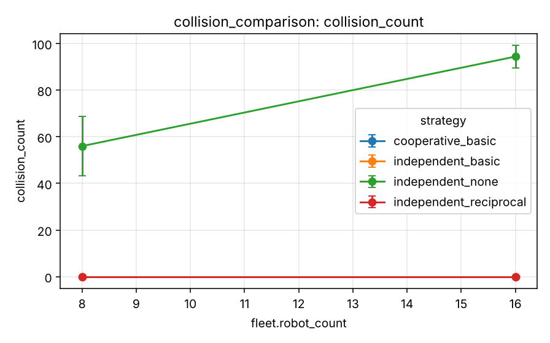

# Experiment 4 - Collision avoidance

**Research question.** What do execution-time avoidance strategies buy, and what do they cost in waiting, deadlocks and completion?

## Design

`experiments/scenarios/collision_comparison.yaml`: strategies {independent planning with no avoidance, with wait-only avoidance, with reciprocal sidestepping, cooperative planning with arbitration}, 8/16 robots (quick), 40 tasks, `warehouse_small`, 5 seeds.

## Metrics

Task completion, collision episodes, safety-distance violations, waits, deadlock events, execution time, simulated time, replans. Collisions are never reported alone.

## Results

Generated from `experiments/results/raw/collision_comparison.csv` (mean, SD, 95 % CI per cell; n = seeds x pooled factor levels).

<!-- BEGIN table:collision_comparison -->

**task_completion_rate**

| strategy | fleet.robot_count | n | mean | SD | 95% CI |
|---|---|---|---|---|---|
| cooperative_basic | 8 | 5 | 100.0 | 0.0 | [100.0, 100.0] |
| cooperative_basic | 16 | 5 | 100.0 | 0.0 | [100.0, 100.0] |
| independent_basic | 8 | 5 | 80.0 | 25.4 | [48.4, 111.6] |
| independent_basic | 16 | 5 | 82.5 | 30.3 | [44.9, 120.1] |
| independent_none | 8 | 5 | 100.0 | 0.0 | [100.0, 100.0] |
| independent_none | 16 | 5 | 100.0 | 0.0 | [100.0, 100.0] |
| independent_reciprocal | 8 | 5 | 100.0 | 0.0 | [100.0, 100.0] |
| independent_reciprocal | 16 | 5 | 100.0 | 0.0 | [100.0, 100.0] |

**collision_count**

| strategy | fleet.robot_count | n | mean | SD | 95% CI |
|---|---|---|---|---|---|
| cooperative_basic | 8 | 5 | 0.000 | 0.000 | [0.000, 0.000] |
| cooperative_basic | 16 | 5 | 0.000 | 0.000 | [0.000, 0.000] |
| independent_basic | 8 | 5 | 0.000 | 0.000 | [0.000, 0.000] |
| independent_basic | 16 | 5 | 0.000 | 0.000 | [0.000, 0.000] |
| independent_none | 8 | 5 | 56.000 | 10.198 | [43.337, 68.663] |
| independent_none | 16 | 5 | 94.400 | 3.847 | [89.623, 99.177] |
| independent_reciprocal | 8 | 5 | 0.000 | 0.000 | [0.000, 0.000] |
| independent_reciprocal | 16 | 5 | 0.000 | 0.000 | [0.000, 0.000] |

**safety_violations**

| strategy | fleet.robot_count | n | mean | SD | 95% CI |
|---|---|---|---|---|---|
| cooperative_basic | 8 | 5 | 61.000 | 14.283 | [43.265, 78.735] |
| cooperative_basic | 16 | 5 | 123.200 | 11.256 | [109.224, 137.176] |
| independent_basic | 8 | 5 | 47.600 | 14.809 | [29.212, 65.988] |
| independent_basic | 16 | 5 | 79.800 | 25.985 | [47.536, 112.064] |
| independent_none | 8 | 5 | 147.200 | 28.761 | [111.488, 182.912] |
| independent_none | 16 | 5 | 243.600 | 8.444 | [233.115, 254.085] |
| independent_reciprocal | 8 | 5 | 70.000 | 7.314 | [60.918, 79.082] |
| independent_reciprocal | 16 | 5 | 112.800 | 11.541 | [98.470, 127.130] |

**wait_steps**

| strategy | fleet.robot_count | n | mean | SD | 95% CI |
|---|---|---|---|---|---|
| cooperative_basic | 8 | 5 | 0.000 | 0.000 | [0.000, 0.000] |
| cooperative_basic | 16 | 5 | 0.000 | 0.000 | [0.000, 0.000] |
| independent_basic | 8 | 5 | 3121.000 | 2532.355 | [-23.333, 6265.333] |
| independent_basic | 16 | 5 | 4892.400 | 5279.290 | [-1662.705, 11447.505] |
| independent_none | 8 | 5 | 0.000 | 0.000 | [0.000, 0.000] |
| independent_none | 16 | 5 | 0.000 | 0.000 | [0.000, 0.000] |
| independent_reciprocal | 8 | 5 | 202.200 | 37.372 | [155.796, 248.604] |
| independent_reciprocal | 16 | 5 | 273.200 | 57.460 | [201.853, 344.547] |

**deadlock_events**

| strategy | fleet.robot_count | n | mean | SD | 95% CI |
|---|---|---|---|---|---|
| cooperative_basic | 8 | 5 | 0.000 | 0.000 | [0.000, 0.000] |
| cooperative_basic | 16 | 5 | 0.000 | 0.000 | [0.000, 0.000] |
| independent_basic | 8 | 5 | 0.800 | 1.095 | [-0.560, 2.160] |
| independent_basic | 16 | 5 | 0.200 | 0.447 | [-0.355, 0.755] |
| independent_none | 8 | 5 | 0.000 | 0.000 | [0.000, 0.000] |
| independent_none | 16 | 5 | 0.000 | 0.000 | [0.000, 0.000] |
| independent_reciprocal | 8 | 5 | 0.000 | 0.000 | [0.000, 0.000] |
| independent_reciprocal | 16 | 5 | 0.000 | 0.000 | [0.000, 0.000] |

<!-- END table:collision_comparison -->

Figures (mean with 95 % CI): see `docs/images/benchmarks/collision_comparison__*.png`.

## Discussion

Collisions fall to zero as soon as arbitration exists, but wait-only arbitration livelocks (head-on robots wait for each other and replan the same way). Reciprocal sidestepping restores 100 % completion at a fraction of the waits; coordinated planning needs no waits. Zero collisions on the grid does not imply clearance in continuous space: safety-distance violations remain.

Interpretation is limited by the quick profile (few seeds, wide CIs; see the [methodology](../research/experimental-methodology.md))
and the abstractions listed in the [limitations](../research/limitations.md). Paired statistics for selected contrasts:
`reports/tables/paired_comparisons.md`.
