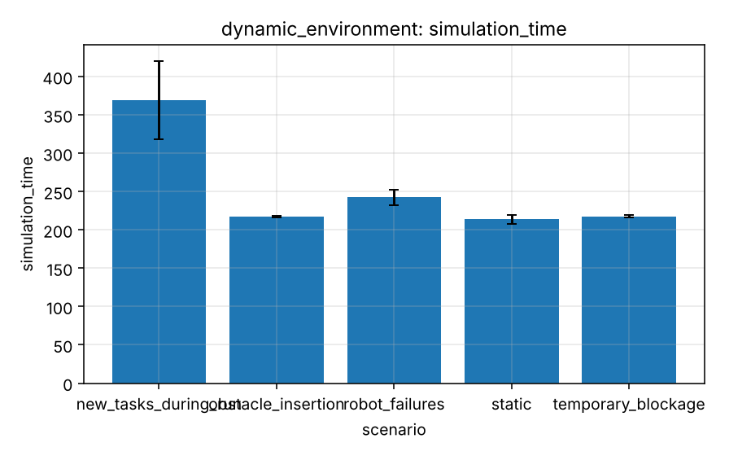

# Experiment 5 - Dynamic environment

**Research question.** How well do plans survive obstacle insertion/removal, temporary blockages, robot failures and tasks that arrive during the run?

## Design

`experiments/scenarios/dynamic_environment.yaml`: static, obstacle insertion (8 permanent), temporary blockage (8 x 25 s), Poisson task arrivals (0.12 tasks/s), 2 temporary robot failures; 10 robots, 40 tasks, 5 seeds.

## Metrics

Task completion, simulated time, replans, travel distance, reassignments, unfinished tasks, average completion time.

## Results

Generated from `experiments/results/raw/dynamic_environment.csv` (mean, SD, 95 % CI per cell; n = seeds x pooled factor levels).

<!-- BEGIN table:dynamic_environment -->

**task_completion_rate**

| scenario | n | mean | SD | 95% CI |
|---|---|---|---|---|
| new_tasks_during_run | 5 | 100.0 | 0.0 | [100.0, 100.0] |
| obstacle_insertion | 5 | 100.0 | 0.0 | [100.0, 100.0] |
| robot_failures | 5 | 100.0 | 0.0 | [100.0, 100.0] |
| static | 5 | 100.0 | 0.0 | [100.0, 100.0] |
| temporary_blockage | 5 | 100.0 | 0.0 | [100.0, 100.0] |

**simulation_time**

| scenario | n | mean | SD | 95% CI |
|---|---|---|---|---|
| new_tasks_during_run | 5 | 369.100 | 41.073 | [318.101, 420.099] |
| obstacle_insertion | 5 | 217.300 | 0.837 | [216.261, 218.339] |
| robot_failures | 5 | 242.300 | 8.468 | [231.786, 252.814] |
| static | 5 | 213.700 | 4.615 | [207.969, 219.431] |
| temporary_blockage | 5 | 217.500 | 1.140 | [216.084, 218.916] |

**replans**

| scenario | n | mean | SD | 95% CI |
|---|---|---|---|---|
| new_tasks_during_run | 5 | 0.000 | 0.000 | [0.000, 0.000] |
| obstacle_insertion | 5 | 7.800 | 5.404 | [1.090, 14.510] |
| robot_failures | 5 | 2.000 | 1.581 | [0.037, 3.963] |
| static | 5 | 0.000 | 0.000 | [0.000, 0.000] |
| temporary_blockage | 5 | 8.000 | 5.339 | [1.371, 14.629] |

**total_distance**

| scenario | n | mean | SD | 95% CI |
|---|---|---|---|---|
| new_tasks_during_run | 5 | 2210.800 | 30.507 | [2172.920, 2248.680] |
| obstacle_insertion | 5 | 1939.600 | 23.554 | [1910.354, 1968.846] |
| robot_failures | 5 | 1965.600 | 30.353 | [1927.912, 2003.288] |
| static | 5 | 1915.400 | 29.450 | [1878.833, 1951.967] |
| temporary_blockage | 5 | 1937.000 | 22.439 | [1909.139, 1964.861] |

**unfinished_tasks**

| scenario | n | mean | SD | 95% CI |
|---|---|---|---|---|
| new_tasks_during_run | 5 | 0.000 | 0.000 | [0.000, 0.000] |
| obstacle_insertion | 5 | 0.000 | 0.000 | [0.000, 0.000] |
| robot_failures | 5 | 0.000 | 0.000 | [0.000, 0.000] |
| static | 5 | 0.000 | 0.000 | [0.000, 0.000] |
| temporary_blockage | 5 | 0.000 | 0.000 | [0.000, 0.000] |

<!-- END table:dynamic_environment -->

Figures (mean with 95 % CI): see `docs/images/benchmarks/dynamic_environment__*.png`.

## Discussion

Only robots whose remaining path crosses a changed cell replan; obstacle scenarios cost a few seconds. Robot failures are the expensive case (detection through heartbeat timeout, cargo reclaim, reassignment). With Poisson arrivals, simulated time is dominated by the arrival process and the per-task completion time is short (no queue).

Interpretation is limited by the quick profile (few seeds, wide CIs; see the [methodology](../research/experimental-methodology.md))
and the abstractions listed in the [limitations](../research/limitations.md). Paired statistics for selected contrasts:
`reports/tables/paired_comparisons.md`.
