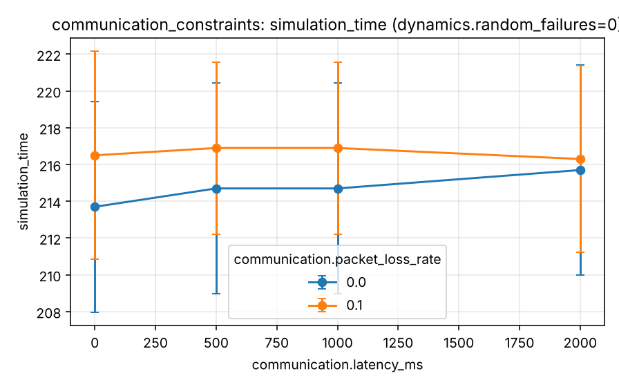

# Experiment 6 - Communication constraints

**Research question.** How sensitive is coordination to latency, packet loss and robot failure?

## Design

`experiments/scenarios/communication_stress.yaml`: latency {0, 500, 1000, 2000} ms (full: 0/50/100/250/500/1000/2000) x loss {0, 10 %} (full: 0/1/5/10 %) x random failures {0, 2}, 10 robots, 40 tasks, 5 seeds, state timeout 2 s. These are simulated stress levels, not recommended settings.

## Metrics

Task completion, simulated time, waiting time, unreachable events, reassignments, dropped/expired messages.

## Results

Generated from `experiments/results/raw/communication_constraints.csv` (mean, SD, 95 % CI per cell; n = seeds x pooled factor levels).

<!-- BEGIN table:communication_constraints -->

**task_completion_rate**

| communication.latency_ms | communication.packet_loss_rate | dynamics.random_failures | n | mean | SD | 95% CI |
|---|---|---|---|---|---|---|
| 0.0 | 0.0 | 0.0 | 5 | 100.0 | 0.0 | [100.0, 100.0] |
| 0.0 | 0.0 | 2.0 | 5 | 100.0 | 0.0 | [100.0, 100.0] |
| 0.0 | 0.1 | 0.0 | 5 | 100.0 | 0.0 | [100.0, 100.0] |
| 0.0 | 0.1 | 2.0 | 5 | 100.0 | 0.0 | [100.0, 100.0] |
| 500.0 | 0.0 | 0.0 | 5 | 100.0 | 0.0 | [100.0, 100.0] |
| 500.0 | 0.0 | 2.0 | 5 | 100.0 | 0.0 | [100.0, 100.0] |
| 500.0 | 0.1 | 0.0 | 5 | 100.0 | 0.0 | [100.0, 100.0] |
| 500.0 | 0.1 | 2.0 | 5 | 100.0 | 0.0 | [100.0, 100.0] |
| 1000.0 | 0.0 | 0.0 | 5 | 100.0 | 0.0 | [100.0, 100.0] |
| 1000.0 | 0.0 | 2.0 | 5 | 100.0 | 0.0 | [100.0, 100.0] |
| 1000.0 | 0.1 | 0.0 | 5 | 100.0 | 0.0 | [100.0, 100.0] |
| 1000.0 | 0.1 | 2.0 | 5 | 100.0 | 0.0 | [100.0, 100.0] |
| 2000.0 | 0.0 | 0.0 | 5 | 100.0 | 0.0 | [100.0, 100.0] |
| 2000.0 | 0.0 | 2.0 | 5 | 100.0 | 0.0 | [100.0, 100.0] |
| 2000.0 | 0.1 | 0.0 | 5 | 100.0 | 0.0 | [100.0, 100.0] |
| 2000.0 | 0.1 | 2.0 | 5 | 100.0 | 0.0 | [100.0, 100.0] |

**simulation_time**

| communication.latency_ms | communication.packet_loss_rate | dynamics.random_failures | n | mean | SD | 95% CI |
|---|---|---|---|---|---|---|
| 0.0 | 0.0 | 0.0 | 5 | 213.700 | 4.615 | [207.969, 219.431] |
| 0.0 | 0.0 | 2.0 | 5 | 242.300 | 8.468 | [231.786, 252.814] |
| 0.0 | 0.1 | 0.0 | 5 | 216.500 | 4.561 | [210.837, 222.163] |
| 0.0 | 0.1 | 2.0 | 5 | 244.300 | 6.907 | [235.724, 252.876] |
| 500.0 | 0.0 | 0.0 | 5 | 214.700 | 4.615 | [208.969, 220.431] |
| 500.0 | 0.0 | 2.0 | 5 | 242.500 | 8.877 | [231.478, 253.522] |
| 500.0 | 0.1 | 0.0 | 5 | 216.900 | 3.768 | [212.221, 221.579] |
| 500.0 | 0.1 | 2.0 | 5 | 245.500 | 5.857 | [238.228, 252.772] |
| 1000.0 | 0.0 | 0.0 | 5 | 214.700 | 4.615 | [208.969, 220.431] |
| 1000.0 | 0.0 | 2.0 | 5 | 242.500 | 8.877 | [231.478, 253.522] |
| 1000.0 | 0.1 | 0.0 | 5 | 216.900 | 3.768 | [212.221, 221.579] |
| 1000.0 | 0.1 | 2.0 | 5 | 245.500 | 5.857 | [238.228, 252.772] |
| 2000.0 | 0.0 | 0.0 | 5 | 215.700 | 4.615 | [209.969, 221.431] |
| 2000.0 | 0.0 | 2.0 | 5 | 244.700 | 7.925 | [234.860, 254.540] |
| 2000.0 | 0.1 | 0.0 | 5 | 216.300 | 4.087 | [211.226, 221.374] |
| 2000.0 | 0.1 | 2.0 | 5 | 245.900 | 6.907 | [237.324, 254.476] |

**average_waiting_time**

| communication.latency_ms | communication.packet_loss_rate | dynamics.random_failures | n | mean | SD | 95% CI |
|---|---|---|---|---|---|---|
| 0.0 | 0.0 | 0.0 | 5 | 67.240 | 0.860 | [66.172, 68.308] |
| 0.0 | 0.0 | 2.0 | 5 | 72.275 | 1.834 | [69.998, 74.552] |
| 0.0 | 0.1 | 0.0 | 5 | 67.470 | 0.736 | [66.556, 68.384] |
| 0.0 | 0.1 | 2.0 | 5 | 72.600 | 1.755 | [70.421, 74.779] |
| 500.0 | 0.0 | 0.0 | 5 | 67.990 | 0.860 | [66.922, 69.058] |
| 500.0 | 0.0 | 2.0 | 5 | 72.980 | 1.818 | [70.723, 75.237] |
| 500.0 | 0.1 | 0.0 | 5 | 68.305 | 0.789 | [67.325, 69.285] |
| 500.0 | 0.1 | 2.0 | 5 | 73.365 | 1.663 | [71.300, 75.430] |
| 1000.0 | 0.0 | 0.0 | 5 | 67.990 | 0.860 | [66.922, 69.058] |
| 1000.0 | 0.0 | 2.0 | 5 | 72.980 | 1.818 | [70.723, 75.237] |
| 1000.0 | 0.1 | 0.0 | 5 | 68.290 | 0.776 | [67.326, 69.254] |
| 1000.0 | 0.1 | 2.0 | 5 | 73.330 | 1.684 | [71.240, 75.420] |
| 2000.0 | 0.0 | 0.0 | 5 | 68.740 | 0.860 | [67.672, 69.808] |
| 2000.0 | 0.0 | 2.0 | 5 | 73.800 | 1.863 | [71.487, 76.113] |
| 2000.0 | 0.1 | 0.0 | 5 | 69.100 | 0.758 | [68.158, 70.042] |
| 2000.0 | 0.1 | 2.0 | 5 | 74.075 | 1.636 | [72.044, 76.106] |

**unreachable_events**

| communication.latency_ms | communication.packet_loss_rate | dynamics.random_failures | n | mean | SD | 95% CI |
|---|---|---|---|---|---|---|
| 0.0 | 0.0 | 0.0 | 5 | 0.000 | 0.000 | [0.000, 0.000] |
| 0.0 | 0.0 | 2.0 | 5 | 1.800 | 0.447 | [1.245, 2.355] |
| 0.0 | 0.1 | 0.0 | 5 | 0.000 | 0.000 | [0.000, 0.000] |
| 0.0 | 0.1 | 2.0 | 5 | 1.800 | 0.447 | [1.245, 2.355] |
| 500.0 | 0.0 | 0.0 | 5 | 0.000 | 0.000 | [0.000, 0.000] |
| 500.0 | 0.0 | 2.0 | 5 | 1.800 | 0.447 | [1.245, 2.355] |
| 500.0 | 0.1 | 0.0 | 5 | 0.400 | 0.548 | [-0.280, 1.080] |
| 500.0 | 0.1 | 2.0 | 5 | 2.400 | 0.894 | [1.289, 3.511] |
| 1000.0 | 0.0 | 0.0 | 5 | 0.000 | 0.000 | [0.000, 0.000] |
| 1000.0 | 0.0 | 2.0 | 5 | 1.800 | 0.447 | [1.245, 2.355] |
| 1000.0 | 0.1 | 0.0 | 5 | 0.000 | 0.000 | [0.000, 0.000] |
| 1000.0 | 0.1 | 2.0 | 5 | 1.800 | 0.447 | [1.245, 2.355] |
| 2000.0 | 0.0 | 0.0 | 5 | 0.000 | 0.000 | [0.000, 0.000] |
| 2000.0 | 0.0 | 2.0 | 5 | 1.800 | 0.447 | [1.245, 2.355] |
| 2000.0 | 0.1 | 0.0 | 5 | 0.200 | 0.447 | [-0.355, 0.755] |
| 2000.0 | 0.1 | 2.0 | 5 | 2.000 | 0.707 | [1.122, 2.878] |

<!-- END table:communication_constraints -->

Figures (mean with 95 % CI): see `docs/images/benchmarks/communication_constraints__*.png`.

## Discussion

Latency up to the 1 s plan step is absorbed (it costs about one decision step: 500 ms and 1000 ms gave identical results); 2000 ms costs about two seconds; 10 % loss adds about two seconds (paired, p = 0.004) and is survived through
retransmission of unacknowledged assignments; healthy robots are occasionally declared unreachable (0.2 per run at 2000 ms + 10 % loss) and recovered. Failures dominate the time cost at every network level.
An earlier version of this experiment exposed a stale-ACK bug (see the benchmark report); the figures here are from the fixed code.

Interpretation is limited by the quick profile (few seeds, wide CIs; see the [methodology](../research/experimental-methodology.md))
and the abstractions listed in the [limitations](../research/limitations.md). Paired statistics for selected contrasts:
`reports/tables/paired_comparisons.md`.
