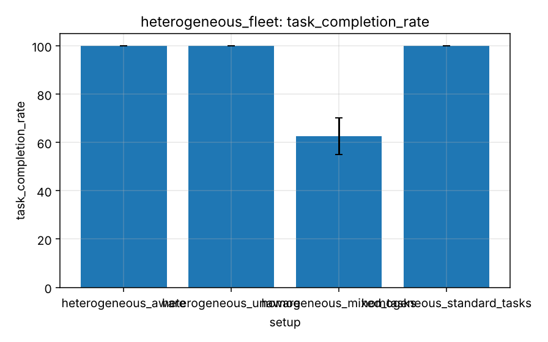

# Experiment 7 - Heterogeneous fleet

**Research question.** What does capability-aware allocation change for a heterogeneous fleet, compared with homogeneous fleets and a capability-unaware baseline?

## Design

`experiments/scenarios/heterogeneous_fleet.yaml`: homogeneous fleet with standard tasks; homogeneous fleet with heavy/fast tasks (infeasible for some); heterogeneous fleet (50 % standard, 25 % heavy, 25 % fast) with and without capability awareness; 12 robots, 40 tasks, 5 seeds.

## Metrics

Completion, unfinished tasks, rejected (infeasible) assignments, workload coefficient of variation, execution time, deadline-met rate, idle time.

## Results

Generated from `experiments/results/raw/heterogeneous_fleet.csv` (mean, SD, 95 % CI per cell; n = seeds x pooled factor levels).

<!-- BEGIN table:heterogeneous_fleet -->

**task_completion_rate**

| setup | n | mean | SD | 95% CI |
|---|---|---|---|---|
| heterogeneous_aware | 5 | 100.0 | 0.0 | [100.0, 100.0] |
| heterogeneous_unaware | 5 | 100.0 | 0.0 | [100.0, 100.0] |
| homogeneous_mixed_tasks | 5 | 62.5 | 6.1 | [54.9, 70.1] |
| homogeneous_standard_tasks | 5 | 100.0 | 0.0 | [100.0, 100.0] |

**unfinished_tasks**

| setup | n | mean | SD | 95% CI |
|---|---|---|---|---|
| heterogeneous_aware | 5 | 0.000 | 0.000 | [0.000, 0.000] |
| heterogeneous_unaware | 5 | 0.000 | 0.000 | [0.000, 0.000] |
| homogeneous_mixed_tasks | 5 | 15.000 | 2.449 | [11.959, 18.041] |
| homogeneous_standard_tasks | 5 | 0.000 | 0.000 | [0.000, 0.000] |

**infeasible_assignments**

| setup | n | mean | SD | 95% CI |
|---|---|---|---|---|
| heterogeneous_aware | 5 | 0.000 | 0.000 | [0.000, 0.000] |
| heterogeneous_unaware | 5 | 59.800 | 11.649 | [45.336, 74.264] |
| homogeneous_mixed_tasks | 5 | 0.000 | 0.000 | [0.000, 0.000] |
| homogeneous_standard_tasks | 5 | 0.000 | 0.000 | [0.000, 0.000] |

**workload_cv**

| setup | n | mean | SD | 95% CI |
|---|---|---|---|---|
| heterogeneous_aware | 5 | 0.154 | 0.029 | [0.118, 0.190] |
| heterogeneous_unaware | 5 | 0.154 | 0.024 | [0.124, 0.184] |
| homogeneous_mixed_tasks | 5 | 0.175 | 0.046 | [0.118, 0.232] |
| homogeneous_standard_tasks | 5 | 0.139 | 0.011 | [0.126, 0.152] |

**average_execution_time**

| setup | n | mean | SD | 95% CI |
|---|---|---|---|---|
| heterogeneous_aware | 5 | 43.087 | 0.990 | [41.858, 44.317] |
| heterogeneous_unaware | 5 | 42.855 | 0.956 | [41.668, 44.042] |
| homogeneous_mixed_tasks | 5 | 29.219 | 0.794 | [28.232, 30.205] |
| homogeneous_standard_tasks | 5 | 28.725 | 0.622 | [27.953, 29.497] |

<!-- END table:heterogeneous_fleet -->

Figures (mean with 95 % CI): see `docs/images/benchmarks/heterogeneous_fleet__*.png`.

## Discussion

A homogeneous fleet cannot do heavy tasks at all. The capability-unaware baseline learns by rejection (each rejected pair is blacklisted), so it still finishes but wastes allocation rounds; awareness avoids them. Heterogeneous fleets run slower (the plan step follows the slowest robot) and heterogeneity does not give fast robots a speed advantage (ADR-0002).

Interpretation is limited by the quick profile (few seeds, wide CIs; see the [methodology](../research/experimental-methodology.md))
and the abstractions listed in the [limitations](../research/limitations.md). Paired statistics for selected contrasts:
`reports/tables/paired_comparisons.md`.
