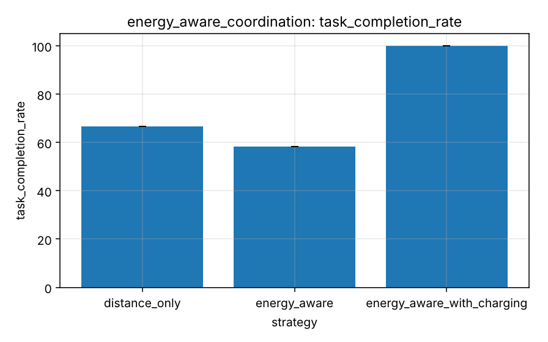

# Experiment 8 - Energy-aware coordination

**Research question.** What do energy-aware allocation and charging change compared with distance-only allocation?

## Design

`experiments/scenarios/energy_aware.yaml`: distance-only (no charging), energy-aware (no charging), energy-aware with charging; 5 robots, 60 tasks, `warehouse_small`, 5 seeds. The energy model is a simplified simulation model.

## Metrics

Completion, unfinished tasks, energy per task, battery depletions, charging utilisation, reserve violations.

## Results

Generated from `experiments/results/raw/energy_aware_coordination.csv` (mean, SD, 95 % CI per cell; n = seeds x pooled factor levels).

<!-- BEGIN table:energy_aware_coordination -->

**task_completion_rate**

| strategy | n | mean | SD | 95% CI |
|---|---|---|---|---|
| distance_only | 5 | 66.7 | 0.0 | [66.7, 66.7] |
| energy_aware | 5 | 58.3 | 0.0 | [58.3, 58.3] |
| energy_aware_with_charging | 5 | 100.0 | 0.0 | [100.0, 100.0] |

**unfinished_tasks**

| strategy | n | mean | SD | 95% CI |
|---|---|---|---|---|
| distance_only | 5 | 20.000 | 0.000 | [20.000, 20.000] |
| energy_aware | 5 | 25.000 | 0.000 | [25.000, 25.000] |
| energy_aware_with_charging | 5 | 0.000 | 0.000 | [0.000, 0.000] |

**energy_per_task**

| strategy | n | mean | SD | 95% CI |
|---|---|---|---|---|
| distance_only | 5 | 50.069 | 0.017 | [50.047, 50.090] |
| energy_aware | 5 | 50.604 | 0.513 | [49.968, 51.241] |
| energy_aware_with_charging | 5 | 53.913 | 1.169 | [52.462, 55.364] |

**battery_depletions**

| strategy | n | mean | SD | 95% CI |
|---|---|---|---|---|
| distance_only | 5 | 5.000 | 0.000 | [5.000, 5.000] |
| energy_aware | 5 | 0.000 | 0.000 | [0.000, 0.000] |
| energy_aware_with_charging | 5 | 0.000 | 0.000 | [0.000, 0.000] |

**charging_utilization**

| strategy | n | mean | SD | 95% CI |
|---|---|---|---|---|
| distance_only | 5 | 0.000 | 0.000 | [0.000, 0.000] |
| energy_aware | 5 | 0.000 | 0.000 | [0.000, 0.000] |
| energy_aware_with_charging | 5 | 0.043 | 0.003 | [0.038, 0.047] |

<!-- END table:energy_aware_coordination -->

Figures (mean with 95 % CI): see `docs/images/benchmarks/energy_aware_coordination__*.png`.

## Discussion

Without charging, the energy supply caps the achievable work; energy awareness prevents stranded robots (battery depletions) but leaves reserve energy unused. With charging the whole workload completes at a modest increase in energy per task (detours to chargers).

Interpretation is limited by the quick profile (few seeds, wide CIs; see the [methodology](../research/experimental-methodology.md))
and the abstractions listed in the [limitations](../research/limitations.md). Paired statistics for selected contrasts:
`reports/tables/paired_comparisons.md`.
